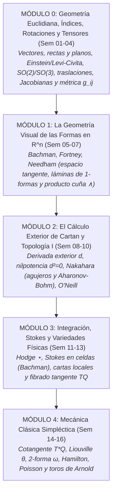

# Geometría y Física I: Mecánica Clásica y Formas de Cartan

**Nivel:** Licenciatura en Física e Ingeniería (Undergraduate)  
**Duración:** 1 Semestre (16 Semanas / 16 Unidades de Aprendizaje)  
**Audiencia:** Estudiantes de física e ingeniería que han cursado el cálculo diferencial e integral tradicional de una y dos variables, y buscan una transición sólida, intuitiva, constructivista y visual hacia la física teórica, la mecánica analítica y la geometría moderna.  
**Pedagogía («La Necesidad Crea la Herramienta»):** Constructivista, inductiva, visual y acumulativa. Cada semana parte de un problema físico o de ingeniería concreto donde las herramientas ingenuas entran en crisis, motivando al estudiante a construir por sí mismo la herramienta geométrica (desde vectores, rectas, planos e índices en $\mathbb{R}^3$, hasta las mallas de Cartan, las variedades diferenciables y la geometría simpléctica de Arnold, José & Saletan).

---

## 🎯 Prerrequisitos del Curso

Este curso fue diseñado cuidadosamente para **no asumir conocimientos avanzados previos** de cálculo vectorial avanzado, álgebra tensorial abstracta, topología general formal ni mecánica analítica lagrangiana/hamiltoniana.

### Lo que SÍ se requiere (Mínimos necesarios)
1. **Cálculo Diferencial e Integral en 1 variable:**
   * Derivadas ordinarias, regla de la cadena y linealidad.
   * Teorema Fundamental del Cálculo en $\mathbb{R}$ e integración básica (sustitución y por partes).
2. **Cálculo Diferencial e Integral en 2 y 3 variables (nivel básico):**
   * Derivadas parciales $\frac{\partial f}{\partial x}$, $\frac{\partial f}{\partial y}$.
   * Teorema de Schwarz de simetría de derivadas cruzadas: $\frac{\partial^2 f}{\partial x \partial y} = \frac{\partial^2 f}{\partial y \partial x}$.
   * Regla de la cadena multivariable elemental: $\frac{d}{dt} f(x(t), y(t)) = \frac{\partial f}{\partial x}\dot{x} + \frac{\partial f}{\partial y}\dot{y}$.
   * Integrales dobles simples en coordenadas cartesianas y cambio elemental a coordenadas polares en $\mathbb{R}^2$.
3. **Álgebra y Trigonometría Elemental:**
   * Coordenadas cartesianas en $\mathbb{R}^2$ y $\mathbb{R}^3$, Teorema de Pitágoras y Ley de Cosenos.
   * Sistemas de ecuaciones lineales de $2\times 2$ y $3\times 3$, y noción básica de matrices.
4. **Física General Elemental (Mecánica Newtoniana):**
   * Leyes de Newton ($\vec{F} = m\vec{a}$), trabajo mecánico elemental, energía cinética $T = \frac{1}{2}mv^2$ y energía potencial $V(\vec{r})$.

---

### Lo que NO se requiere (Se construye desde cero en el curso)
* ❌ **NO se requiere Geometría Analítica Vectorial previa:** La Semana 01 construye desde cero la diferencia entre puntos y vectores, la suma por paralelogramo, el producto punto como proyección de sombras, el producto cruz como área orientada, y la dualidad paramétrica vs. normal de rectas y planos en $\mathbb{R}^3$.
* ❌ **NO se requiere Álgebra Tensorial ni Grupos de Lie previos:** El Módulo 0 construye paso a paso la notación de Einstein, $\delta_{ij}$, Levi-Civita $\epsilon_{ijk}$, el grupo de rotaciones $SO(2)$ y $SO(3)$ (incluyendo rotaciones infinitesimales y diferencias con las traslaciones), matrices Jacobianas y el tensor métrico $g_{ij}$.
* ❌ **NO se requiere Topología General abstracta:** Conceptos como conexidad, compacidad, orientabilidad y cohomología de de Rham se introducen de manera visual y *just-in-time* cuando la física lo exige (agujeros de Aharonov-Bohm, celdas en Stokes y toros de Arnold).
* ❌ **NO se requiere Mecánica Lagrangiana ni Hamiltoniana formal previa:** El formalismo se construye de forma natural a partir de la geometría de los espacios de configuración $Q$, el fibrado tangente $TQ$ y el fibrado cotangente $T^*Q$.

---

## 🏛️ Los Pilares Bibliográficos

| Obra de Referencia | Rol Pedagógico en el Programa |
| :--- | :--- |
| **David Bachman** (*A Geometric Approach to Differential Forms*) | **El concepto de integrando:** Coordenadas como funciones, 1-formas como medidores de proyección de sombras, 2-formas como determinantes y el Teorema de Stokes como cancelación telescópica interna de celdas. |
| **Jon Pierre Fortney** (*A Visual Introduction to Differential Forms*) | **La imaginería visual concreta:** El modelo de láminas cortadas (*lines-to-be-pierced*), panales de cajitas para 2-formas, tubos de flujo en 3D y la visualización directa de la estrella de Hodge. |
| **Tristan Needham** (*Visual Differential Geometry and Forms*) | **La intuición física primordial:** El trabajo en campos conservativos sin métrica, el mapa topográfico de curvas de nivel y el arrastre por flujos. |
| **Mikio Nakahara** (*Geometry, Topology and Physics*) | **La topología motivada por la física:** Por qué fallan los potenciales globales, efecto Aharonov-Bohm, cuantización de vórtices, dualidad cadenas-formas ($\langle \partial c, \omega \rangle = \langle c, d\omega \rangle$) y variedades sin cuerdas singulares (Wu-Yang). |
| **Barrett O'Neill** (*Elementos de Geometría Diferencial*) | **El cálculo de Cartan en $\mathbb{R}^3$:** Marcos móviles ortonormales $\{e_i\}$, 1-formas de conexión de Cartan $\omega_{ij}$ y las ecuaciones estructurales aplicadas a la dinámica no inercial. |
| **Jorge V. José & Eugene J. Saletan** (*Classical Dynamics*) | **La mecánica analítica contemporánea:** El espacio de configuraciones $Q$, velocidades en el fibrado tangente $TQ$, momentos como covectores en $T^*Q$, y transformaciones canónicas como difeomorfismos simplécticos ($\Phi^*\omega = \omega$). |
| **V.I. Arnold** (*Mathematical Methods of Classical Mechanics*) | **La cumbre geométrica:** El invariante integral de Poincaré-Cartan $\oint (p\,dq - H\,dt)$, las trayectorias como líneas de vórtice de $d\omega_H$, hidrodinámica incompresible del espacio de fases y toros invariantes. |
| **John Baez & Javier P. Muniain** (*Gauge Fields, Knots and Gravity*) | **El puente al futuro:** Unificación de Maxwell en dos líneas ($dF=0, d{\star}F=J$) y preparación para Teorías de Norma y Fases de Berry. |

---

## 🗺️ Mapa Curricular del Semestre (16 Semanas)



---

## 📅 Tabla de Navegación del Semestre

| Módulo | Semana | Tema Central | Pregunta Física / Geométrica Motivadora | Carpeta | Estado |
| :--- | :---: | :--- | :--- | :--- | :---: |
| [**MÓDULO 0**](Modulo_00_Arsenal_Indicial/README.md) | **01** | Geometría de Vectores, Proyecciones, Rectas y Planos | ¿Cómo distinguimos puntos de flechas y por qué un plano tiene dos caras duales (paramétrica vs. normal)? | [`Semana_01`](Modulo_00_Arsenal_Indicial/Semana_01_Geometria_Vectores_Rectas_Planos) | ✅ |
| [**MÓDULO 0**](Modulo_00_Arsenal_Indicial/README.md) | **02** | Notación de Einstein, $\delta_{ij}$, Levi-Civita $\epsilon_{ijk}$ y Determinantes | ¿Cómo simplificar identidades vectoriales y volúmenes en 3D sin llenar páginas de componentes? | [`Semana_02`](Modulo_00_Arsenal_Indicial/Semana_02_Einstein_Kronecker_LeviCivita) | ✅ |
| [**MÓDULO 0**](Modulo_00_Arsenal_Indicial/README.md) | **03** | El Grupo de Rotaciones $SO(2), SO(3)$ y Traslaciones | ¿Por qué $R^TR=I$, $\det R=+1$ y los giros 3D no conmutan? ¿En qué difiere rotar de trasladar? | [`Semana_03`](Modulo_00_Arsenal_Indicial/Semana_03_Rotaciones_SO2_SO3_Traslaciones) | ⏳ |
| [**MÓDULO 0**](Modulo_00_Arsenal_Indicial/README.md) | **04** | Matrices Jacobianas, Coordenadas Curvas y Métrica $g_{ij}$ | ¿Por qué aparecen factores de escala como $r$ o $r^2\sin\theta$ al medir distancias y áreas en coordenadas curvas? | [`Semana_04`](Modulo_00_Arsenal_Indicial/Semana_04_Jacobianas_Curvilineas_Metrica) | ⏳ |
| [**MÓDULO 1**](Modulo_01_Geometria_Visual_Rn/README.md) | **05** | Puntos, Coordenadas y Vectores como Derivaciones | ¿Qué diferencia física hay entre una ubicación y una velocidad sobre una superficie curva? | [`Semana_05`](Modulo_01_Geometria_Visual_Rn/Semana_05_Puntos_Coordenadas_Vectores) | ✅ |
| [**MÓDULO 1**](Modulo_01_Geometria_Visual_Rn/README.md) | **06** | Covectores, 1-Formas como Láminas e Isomorfismos | ¿Por qué el trabajo $P\,dV$ o $df(\vec{v})$ cuenta láminas perforadas sin usar ángulos? | [`Semana_06`](Modulo_01_Geometria_Visual_Rn/Semana_06_Covectores_1Formas_Laminas) | ⏳ |
| [**MÓDULO 1**](Modulo_01_Geometria_Visual_Rn/README.md) | **07** | Álgebra Exterior: El Producto Cuña ($\wedge$) | ¿Cómo medimos áreas y volúmenes orientados en cualquier dimensión sin regla de la mano derecha? | [`Semana_07`](Modulo_01_Geometria_Visual_Rn/Semana_07_Wedge_Areas_Orientadas) | ⏳ |
| [**MÓDULO 2**](Modulo_02_Calculo_Cartan_Topologia_I/README.md) | **08** | Derivada Exterior $d$: Densidad de Circulación | ¿Qué mide un pequeño molinete sumergido en un fluido o campo de fuerzas? | [`Semana_08`](Modulo_02_Calculo_Cartan_Topologia_I/Semana_08_Derivada_Exterior_Circulacion) | ⏳ |
| [**MÓDULO 2**](Modulo_02_Calculo_Cartan_Topologia_I/README.md) | **09** | Nilpotencia $d^2=0$, Poincaré y Topología I | Si $\vec{\nabla}\times\vec{F}=0$, ¿por qué un agujero en el espacio destruye la existencia del potencial global? | [`Semana_09`](Modulo_02_Calculo_Cartan_Topologia_I/Semana_09_Nilpotencia_Poincare_Topologia) | ⏳ |
| [**MÓDULO 2**](Modulo_02_Calculo_Cartan_Topologia_I/README.md) | **10** | Contracción Interior ($\iota_X$) y Marcos Móviles | ¿Cómo describe la física un observador en una plataforma o aeronave que acelera y gira? | [`Semana_10`](Modulo_02_Calculo_Cartan_Topologia_I/Semana_10_Contraccion_Marcos_Moviles) | ⏳ |
| [**MÓDULO 3**](Modulo_03_Integracion_Stokes_Variedades/README.md) | **11** | Integración de Formas y Estrella de Hodge ($\star$) | ¿Cómo integramos flujos sobre superficies sin depender de parametrizaciones ni normales unitarias? | [`Semana_11`](Modulo_03_Integracion_Stokes_Variedades/Semana_11_Hodge_Integracion_Formas) | ⏳ |
| [**MÓDULO 3**](Modulo_03_Integracion_Stokes_Variedades/README.md) | **12** | Teorema Generalizado de Stokes y Topología II | ¿Por qué la suma de remolinos microscópicos internos equivale exactamente a la circulación en el borde? | [`Semana_12`](Modulo_03_Integracion_Stokes_Variedades/Semana_12_Stokes_Celdas_Topologia_II) | ⏳ |
| [**MÓDULO 3**](Modulo_03_Integracion_Stokes_Variedades/README.md) | **13** | Espacios de Configuración ($Q$) y Fibrado Tangente $TQ$ | Si un brazo robótico o péndulo doble se mueve, ¿en qué variedad geométrica vive su estado? | [`Semana_13`](Modulo_03_Integracion_Stokes_Variedades/Semana_13_Espacios_Configuracion_TQ) | ⏳ |
| [**MÓDULO 4**](Modulo_04_Mecanica_Simplectica/README.md) | **14** | Cotangente $T^*Q$, Forma de Liouville $\theta$ y Simpléctica $\omega$ | ¿Por qué el momento canónico $p$ es una 1-forma y qué estructura geométrica gobierna el espacio de fases? | [`Semana_14`](Modulo_04_Mecanica_Simplectica/Semana_14_Cotangente_Liouville_FormaSimplectica) | ⏳ |
| [**MÓDULO 4**](Modulo_04_Mecanica_Simplectica/README.md) | **15** | Dinámica Hamiltoniana, Corchetes de Poisson y Liouville | ¿Por qué el flujo hamiltoniano es incompresible en el espacio de fases ($\mathcal{L}_{X_H}\omega = 0$)? | [`Semana_15`](Modulo_04_Mecanica_Simplectica/Semana_15_Hamilton_Poisson_Liouville) | ⏳ |
| [**MÓDULO 4**](Modulo_04_Mecanica_Simplectica/README.md) | **16** | Poincaré-Cartan, Toros Invariantes de Arnold y Futuro | ¿Por qué los sistemas integrables se enrollan en toros $T^n$ y cómo conecta esto con Maxwell y Gauge? | [`Semana_16`](Modulo_04_Mecanica_Simplectica/Semana_16_PoincareCartan_Toros_Futuro) | ⏳ |

---

## 🛠️ Estructura del Repositorio y Compilación

Cada carpeta de semana contiene el tríptico constructivista estándar:
* `Lectura_XX.tex` y `Lectura_XX.pdf`: Notas de estudio con diseño editorial en `tcolorbox` y abundantes diagramas geométricos en TikZ.
* `Slides_XX.tex` y `Slides_XX.pdf`: Diapositivas Beamer 16:9 interactivas en modalidad taller (*Actividad $\to$ Discusión*).
* `Tarea_XX.tex` y `Tarea_XX.pdf`: Problemas constructivistas divididos en (A) Construcción Visual y Geométrica, (B) Construcción Algebraica y (C) Aplicaciones en Física e Ingeniería.

Para compilar cualquier documento:
```bash
cd Modulo_00_Arsenal_Indicial/Semana_01_Geometria_Vectores_Rectas_Planos/
pdflatex Lectura_01.tex
pdflatex Slides_01.tex
pdflatex Tarea_01.tex
```
Los archivos de configuración compartidos residen en [`Common/`](Common/):
* `Common/course_notes.sty`: Estilos tipográficos y cajas para notas y tareas.
* `Common/course_slides.sty`: Plantilla Beamer 16:9 widescreen.
* `Common/course_macros.sty`: Macros estandarizadas para cálculo de Cartan y física ($\extd, \iprod, \Lie, \hodge, \flatm, \sharpm, \poisson{\cdot}{\cdot}$).
