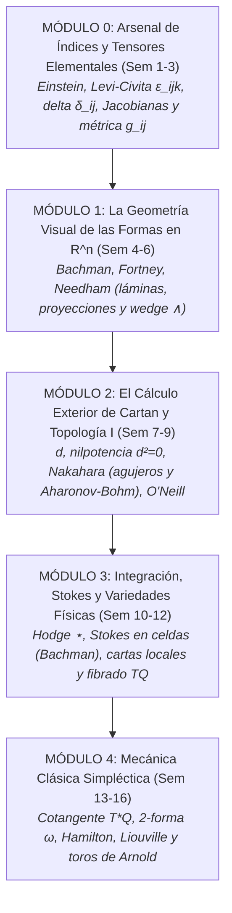

# Geometría y Física I: Mecánica Clásica y Formas de Cartan

**Nivel:** Licenciatura en Física (Undergraduate)  
**Duración:** 1 Semestre (16 Semanas / 16 Unidades de Aprendizaje)  
**Audiencia:** Estudiantes de física e ingeniería que han cursado el cálculo diferencial e integral tradicional de una y dos variables, y buscan una transición sólida, intuitiva y visual hacia la física teórica y la geometría moderna.  
**Pedagogía:** Inductiva, visual, física y acumulativa (de las identidades de índices en $\mathbb{R}^3$ y las mallas de Cartan, a las variedades diferenciables y la geometría simpléctica de Arnold, José & Saletan).

---

## 🎯 Prerrequisitos del Curso

Este curso fue diseñado cuidadosamente para **no asumir conocimientos avanzados previos** de cálculo tensorial abstracto, topología general formal ni mecánica analítica lagrangiana/hamiltoniana.

### Lo que SÍ se requiere (Mínimos necesarios)
1. **Cálculo Diferencial e Integral en 1 variable:**
   * Derivadas ordinarias, regla de la cadena y linealidad.
   * Teorema Fundamental del Cálculo en $\mathbb{R}$ e integración básica (sustitución y por partes).
2. **Cálculo Diferencial e Integral en 2 y 3 variables (nivel tradicional):**
   * Derivadas parciales $\frac{\partial f}{\partial x}$, $\frac{\partial f}{\partial y}$.
   * Teorema de Schwarz de simetría de derivadas cruzadas: $\frac{\partial^2 f}{\partial x \partial y} = \frac{\partial^2 f}{\partial y \partial x}$.
   * Regla de la cadena multivariable elemental: $\frac{d}{dt} f(x(t), y(t)) = \frac{\partial f}{\partial x}\dot{x} + \frac{\partial f}{\partial y}\dot{y}$.
   * Integrales dobles simples en coordenadas cartesianas y cambio elemental a coordenadas polares en $\mathbb{R}^2$.
3. **Álgebra Lineal Elemental:**
   * Vectores en $\mathbb{R}^2$ y $\mathbb{R}^3$, producto escalar euclidiano $\vec{u}\cdot\vec{v}$ y producto vectorial $\vec{u}\times\vec{v}$.
   * Matrices $2\times 2$ y $3\times 3$: multiplicación matricial y cálculo de determinantes (por cofactores o regla de Sarrus).
   * Noción elemental de independencia lineal y bases canónicas $\{\hat{i}, \hat{j}, \hat{k}\}$.
4. **Física General Elemental (Mecánica Newtoniana):**
   * Leyes de Newton ($\vec{F} = m\vec{a}$).
   * Trabajo mecánico elemental como integral de línea: $W = \int \vec{F}\cdot d\vec{r}$.
   * Energía cinética $T = \frac{1}{2}mv^2$ y energía potencial $V(\vec{r})$ con $\vec{F} = -\vec{\nabla}V$.
   * Momento lineal $\vec{p} = m\vec{v}$, momento angular $\vec{L} = \vec{r}\times\vec{p}$ y el oscilador armónico simple en 1D.

---

### Lo que NO se requiere (Se construye desde cero)
* ❌ **NO se requiere Cálculo Vectorial avanzado:** No necesitas memorizar tablas de identidades con gradientes, divergencias, rotacionales ni parametrizaciones engorrosas; todo se reconstruirá y unificará visualmente con las formas de Cartan.
* ❌ **NO se requiere Álgebra Tensorial previa:** El Módulo 0 enseña desde cero la notación de Einstein, el símbolo de Levi-Civita $\epsilon_{ijk}$, la delta de Kronecker $\delta_{ij}$ y las matrices Jacobianas.
* ❌ **NO se requiere Topología General abstracta:** Conceptos como conexidad, compacidad, orientabilidad y cohomología de de Rham se introducen de manera intuitiva y *just-in-time* cuando la física lo exige (agujeros de Aharonov-Bohm, celdas en Stokes y toros de Arnold).
* ❌ **NO se requiere Mecánica Lagrangiana ni Hamiltoniana formal previa:** El formalismo se deriva de forma natural a partir de la geometría del fibrado cotangente $T^*Q$.

---

### Test Rápido de Autoevaluación
Si puedes responder afirmativamente a estas 4 preguntas, estás listo para comenzar:
1. *¿Sabes calcular $\frac{\partial}{\partial x}\big(x^2 y + \sin(xy)\big)$?*
2. *¿Sabes calcular el determinante de $\begin{pmatrix} 2 & 1 \\ 3 & 4 \end{pmatrix}$?*
3. *¿Sabes cómo se calcula el producto cruz $\vec{A} \times \vec{B}$ en $\mathbb{R}^3$?*
4. *¿Recuerdas la definición de trabajo elemental $dW = \vec{F}\cdot d\vec{r}$ y la conservación de la energía mecánica $E = T + V$?*

---

## 🏛️ Los Pilares Bibliográficos

| Obra de Referencia | Rol Pedagógico en el Programa |
| :--- | :--- |
| **David Bachman** (*A Geometric Approach to Differential Forms*) | **El concepto de integrando:** Coordenadas como funciones, 1-formas como medidores de proyección de sombras, 2-formas como determinantes y el Teorema de Stokes como cancelación telescópica interna de celdas. |
| **Jon Pierre Fortney** (*A Visual Introduction to Differential Forms*) | **La imaginería visual concreta:** El modelo de láminas cortadas (*lines-to-be-pierced*), panales de cajitas para 2-formas, tubos de flujo en 3D y la visualización directa de la estrella de Hodge. |
| **Tristan Needham** (*Visual Differential Geometry and Forms*) | **La intuición física primordial:** El trabajo en campos conservativos sin métrica, el mapa topográfico de curvas de nivel y el arrastre por flujos. |
| **Mikio Nakahara** (*Geometry, Topology and Physics*) | **La topología motivada por la física:** Por qué fallan los potenciales globales, efecto Aharonov-Bohm, cuantización de vórtices, dualidad cadenas-formas ($\langle \partial c, \omega \rangle = \langle c, d\omega \rangle$) y variedades sin cuerdas singulares (Wu-Yang). |
| **Barrett O'Neill** (*Elementos de Geometría Diferencial*) | **El cálculo de Cartan en $\mathbb{R}^3$:** Marcos móviles ortonormales $\{e_i\}$, 1-formas de conexión de Cartan $\omega_{ij}$ y las ecuaciones estructurales aplicadas a la dinámica no inercial. |
| **Jorge V. José & Eugene J. Saletan** (*Classical Dynamics*) | **La mecánica analítica contemporánea:** El espacio de configuraciones $Q$, velocidades en el fibrado tangente $TQ$, momentos como covectores en $T^*Q$, y transformaciones canónicas como difeomorfismos simplécticos ($\Phi^*\omega = \omega$). |
| **V.I. Arnold** (*Mathematical Methods of Classical Mechanics*) | **La cumbre geométrica:** El invariante integral de Poincaré-Cartan $\oint (p\,dq - H\,dt)$, las trayectorias como líneas de vórtice de $d\omega_H$, hidrodinámica incompresible del espacio de fases y toros invariantes. |
| **John Baez & Javier P. Muniain** (*Gauge Fields, Knots and Gravity*) | **El puente al futuro:** Unificación de Maxwell en dos líneas ($dF=0, d{\star}F=J$) y preparación para las Partes 2 y 3 (Teorías de Norma y Fases de Berry). |

---

## 🗺️ Mapa Curricular del Semestre (16 Semanas)



---

## 📅 Tabla de Navegación del Semestre

| Módulo | Semana | Tema Central | Pregunta Física Motivadora | Carpeta |
| :--- | :---: | :--- | :--- | :--- |
| [**MÓDULO 0**](Modulo_00_Arsenal_Indicial/README.md) | **01** | Notación de Einstein, $\delta_{ij}$ y Levi-Civita $\epsilon_{ijk}$ | ¿Cómo simplificar cálculos de vectores en 3D sin llenar páginas de componentes? | [`Semana_01`](Modulo_00_Arsenal_Indicial/Semana_01_Einstein_Kronecker_LeviCivita) |
| [**MÓDULO 0**](Modulo_00_Arsenal_Indicial/README.md) | **02** | Jacobianas, Regla de la Cadena y Determinantes | ¿Por qué aparece el factor $r$ o $r^2\sin\theta$ al cambiar de coordenadas? | [`Semana_02`](Modulo_00_Arsenal_Indicial/Semana_02_Jacobianas_Determinantes_ReglaCadena) |
| [**MÓDULO 0**](Modulo_00_Arsenal_Indicial/README.md) | **03** | Simetría, Métrica Euclidiana y Diferenciales | ¿Por qué el trabajo $\delta W$ no es diferencial de una función de estado? | [`Semana_03`](Modulo_00_Arsenal_Indicial/Semana_03_Simetria_Metrica_Diferenciales) |
| [**MÓDULO 1**](Modulo_01_Geometria_Visual_Rn/README.md) | **04** | Puntos, Coordenadas y Vectores como Derivaciones | ¿Qué diferencia física hay entre un lugar y una velocidad? | [`Semana_04`](Modulo_01_Geometria_Visual_Rn/Semana_04_Puntos_Coordenadas_Vectores) |
| [**MÓDULO 1**](Modulo_01_Geometria_Visual_Rn/README.md) | **05** | Covectores, 1-Formas como Láminas e Isomorfismos | ¿Por qué el trabajo $P\,dV$ no necesita ángulos ni producto punto? | [`Semana_05`](Modulo_01_Geometria_Visual_Rn/Semana_05_Covectores_1Formas_Laminas) |
| [**MÓDULO 1**](Modulo_01_Geometria_Visual_Rn/README.md) | **06** | Álgebra Exterior: El Producto Cuña ($\wedge$) | ¿Cómo medimos áreas orientadas sin recurrir a la mano derecha en 3D? | [`Semana_06`](Modulo_01_Geometria_Visual_Rn/Semana_06_Wedge_Areas_Orientadas) |
| [**MÓDULO 2**](Modulo_02_Calculo_Cartan_Topologia_I/README.md) | **07** | Derivada Exterior $d$: Densidad de Circulación | ¿Qué mide una pequeña rueda de paletas en un fluido en 2D? | [`Semana_07`](Modulo_02_Calculo_Cartan_Topologia_I/Semana_07_Derivada_Exterior_Circulacion) |
| [**MÓDULO 2**](Modulo_02_Calculo_Cartan_Topologia_I/README.md) | **08** | Nilpotencia $d^2=0$, Poincaré y Topología I | Si $\vec{\nabla}\times\vec{F}=0$, ¿por qué a veces no existe potencial global? | [`Semana_08`](Modulo_02_Calculo_Cartan_Topologia_I/Semana_08_Nilpotencia_Poincare_Topologia) |
| [**MÓDULO 2**](Modulo_02_Calculo_Cartan_Topologia_I/README.md) | **09** | Contracción Interior ($\iota_X$) y Marcos Móviles | ¿Cómo describe la física un piloto en un caza que acelera y gira? | [`Semana_09`](Modulo_02_Calculo_Cartan_Topologia_I/Semana_09_Contraccion_Marcos_Moviles) |
| [**MÓDULO 3**](Modulo_03_Integracion_Stokes_Variedades/README.md) | **10** | Integración y Estrella de Hodge ($\star$) | ¿Cómo medimos flujos sobre superficies sin usar el vector normal $\hat{n}$? | [`Semana_10`](Modulo_03_Integracion_Stokes_Variedades/Semana_10_Hodge_Integracion_Formas) |
| [**MÓDULO 3**](Modulo_03_Integracion_Stokes_Variedades/README.md) | **11** | Teorema Generalizado de Stokes y Topología II | ¿Por qué la suma de remolinos internos da la velocidad en el borde? | [`Semana_11`](Modulo_03_Integracion_Stokes_Variedades/Semana_11_Stokes_Celdas_Topologia_II) |
| [**MÓDULO 3**](Modulo_03_Integracion_Stokes_Variedades/README.md) | **12** | Espacios de Configuración ($Q$) y Fibrado $TQ$ | Si un péndulo doble se mueve, ¿dónde vive su estado físico real? | [`Semana_12`](Modulo_03_Integracion_Stokes_Variedades/Semana_12_Espacios_Configuracion_TQ) |
| [**MÓDULO 4**](Modulo_04_Mecanica_Simplectica/README.md) | **13** | Fibrado Cotangente $T^*Q$ y Forma de Liouville $\theta$ | ¿Por qué el momento $p$ es físicamente un covector y no un vector? | [`Semana_13`](Modulo_04_Mecanica_Simplectica/Semana_13_Cotangente_TstarQ_Liouville) |
| [**MÓDULO 4**](Modulo_04_Mecanica_Simplectica/README.md) | **14** | 2-Forma Simpléctica $\omega$ y Teorema de Darboux | ¿Qué estructura geométrica reemplaza a la métrica en el espacio de fases? | [`Semana_14`](Modulo_04_Mecanica_Simplectica/Semana_14_Forma_Simplectica_Darboux) |
| [**MÓDULO 4**](Modulo_04_Mecanica_Simplectica/README.md) | **15** | Dinámica Hamiltoniana, Poisson y Liouville | ¿Por qué las ecuaciones de Hamilton llevan un signo menos asimétrico? | [`Semana_15`](Modulo_04_Mecanica_Simplectica/Semana_15_Hamilton_Poisson_Liouville) |
| [**MÓDULO 4**](Modulo_04_Mecanica_Simplectica/README.md) | **16** | Poincaré-Cartan, Topología III y Toros de Arnold | ¿Por qué las trayectorias de sistemas conservativos viven sobre toros? | [`Semana_16`](Modulo_04_Mecanica_Simplectica/Semana_16_PoincareCartan_Toros_Futuro) |

---

## 🛠️ Estructura del Repositorio y Compilación

Cada carpeta de semana contiene el tríptico estándar:
* `Lectura_XX.tex`: Notas de estudio con diseño editorial profesional en `tcolorbox`.
* `Slides_XX.tex`: Diapositivas Beamer 16:9 con paleta visual *Black, Orange & Cream*.
* `Tarea_XX.tex`: Ejercicios divididos en (A) Visual/Dibujo, (B) Cálculo y (C) Física Aplicada.

Para compilar cualquier documento:
```bash
cd Modulo_01_Geometria_Visual_Rn/Semana_04_Puntos_Coordenadas_Vectores/
pdflatex Lectura_04.tex
pdflatex Slides_04.tex
pdflatex Tarea_04.tex
```
Los archivos de configuración compartidos residen en [`Common/`](Common/):
* `Common/course_notes.sty`: Estilos tipográficos y cajas para notas y tareas.
* `Common/course_slides.sty`: Plantilla Beamer 16:9 widescreen.
* `Common/course_macros.sty`: Macros estandarizadas para cálculo de Cartan y física ($\extd, \iprod, \Lie, \hodge, \flatm, \sharpm, \poisson{\cdot}{\cdot}$).
